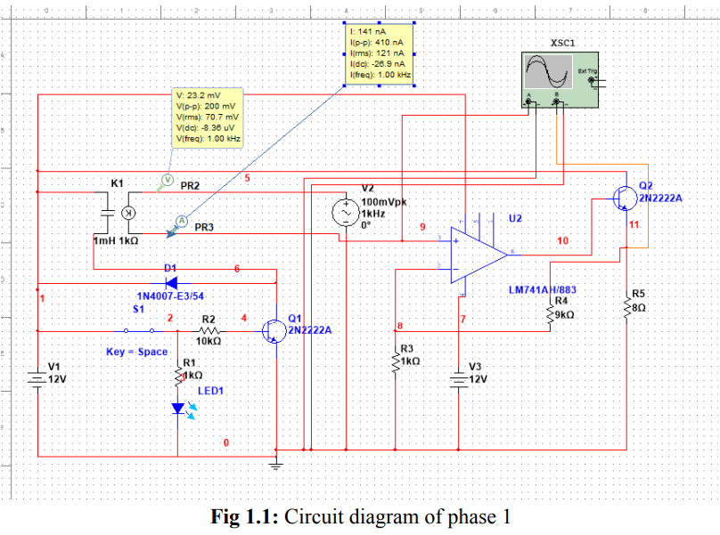
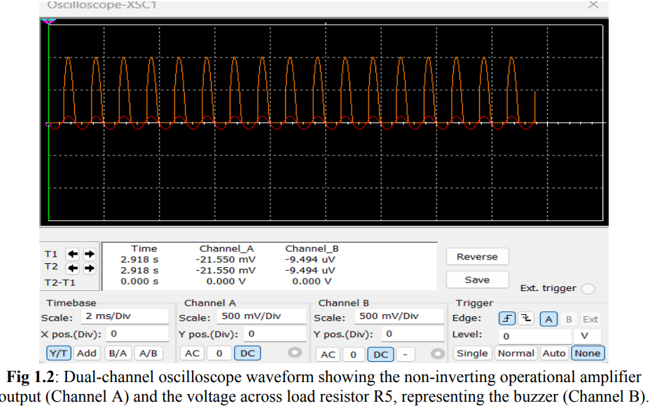
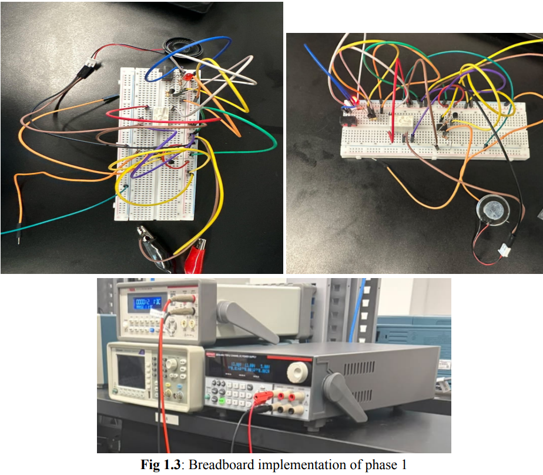
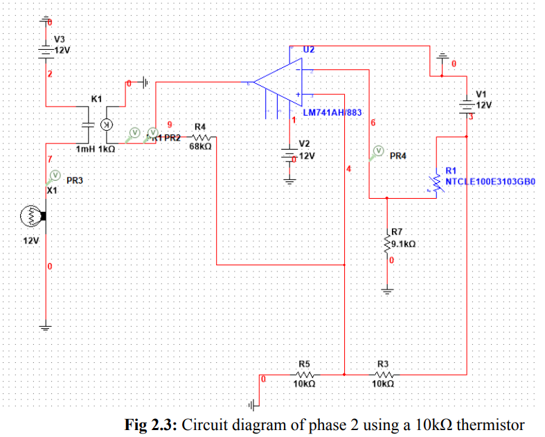
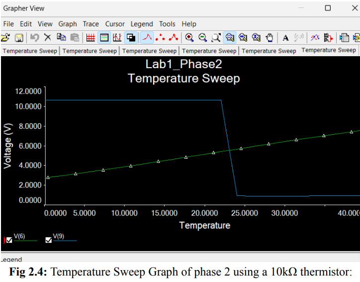
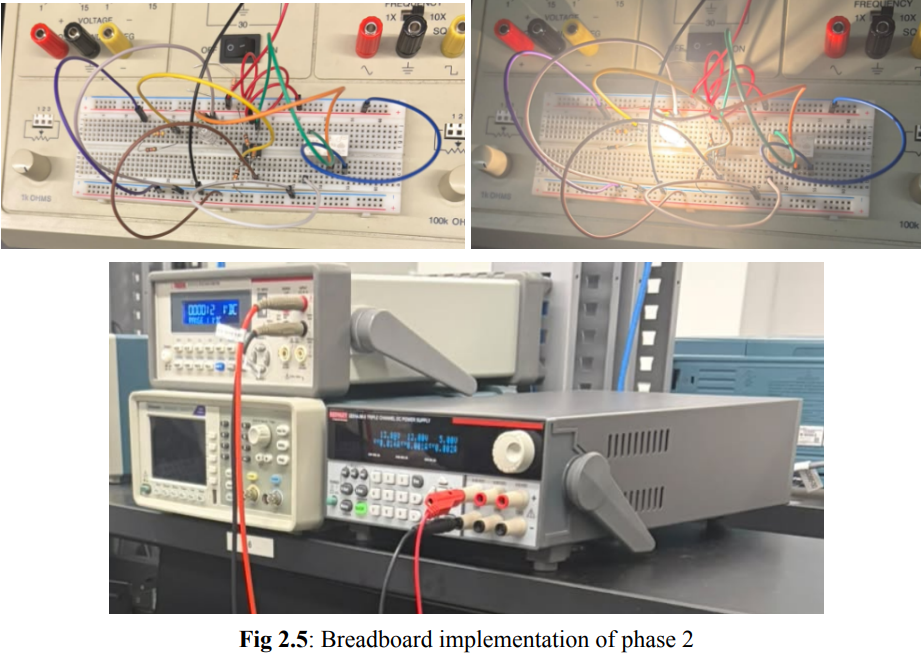
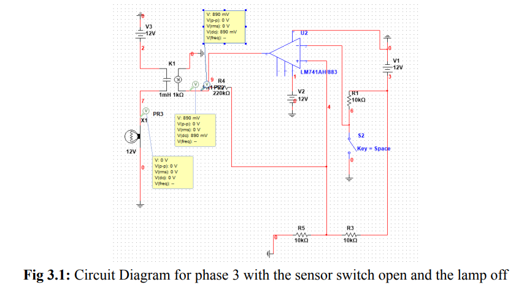
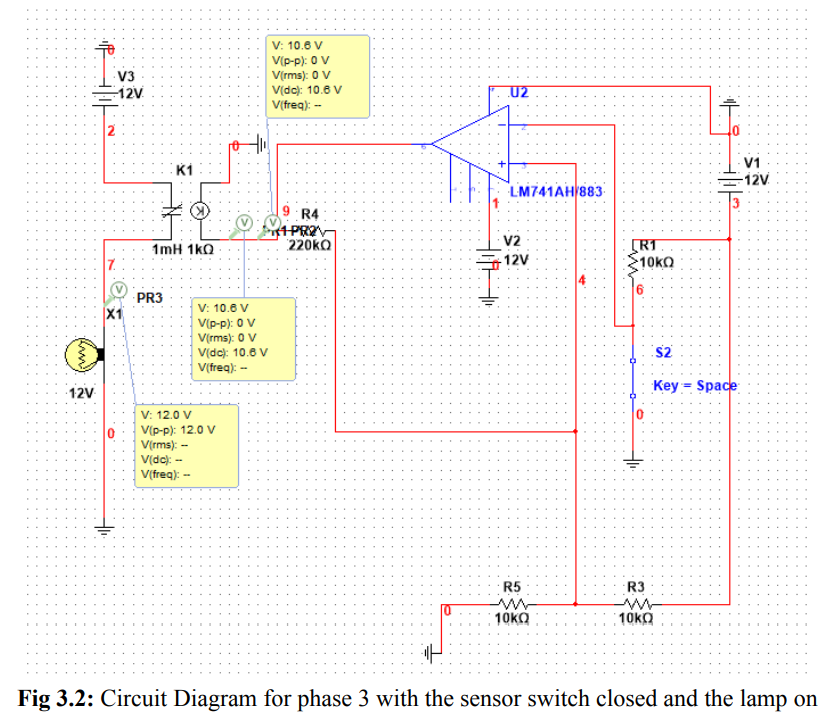
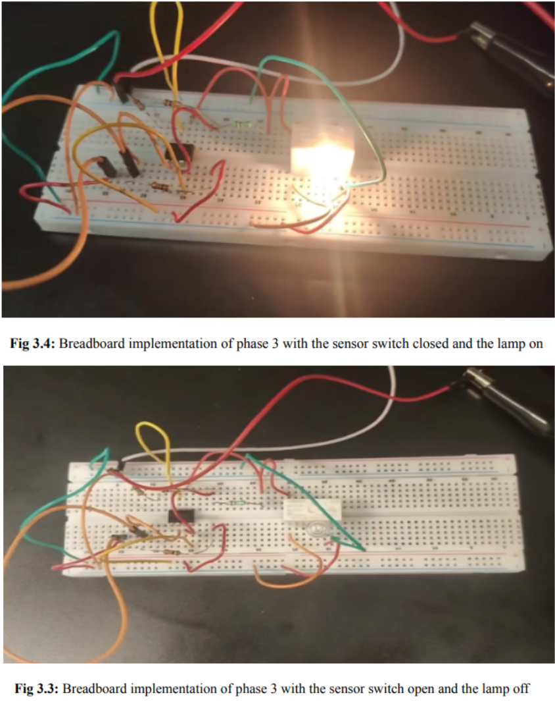

# Op-Amp Sensor Circuits (Multisim / Breadboard)

Three sensor-based monitoring and control circuits designed, simulated in **Multisim**, and built on a breadboard. Each one uses a sensor signal to switch an output device (alarm or halogen lamp) through an LM741 op-amp, a transistor, and a 12 V relay. Built as a lab project at Toronto Metropolitan University.

## What's inside

| Phase | Circuit | Key components |
|---|---|---|
| 1 | Proximity detector with alarm and gain-of-10 amplifier | Slide switch (in place of a reed switch), 2N2222A, 12 V relay, LM741 |
| 2 | Temperature controller (25-30 °C) with hysteresis | 10 kΩ NTC thermistor, LM741 Schmitt trigger, relay, 12 V 20 W halogen lamp |
| 3 | Water level detector | Copper probes, LM741 comparator, relay, lamp |

## Phase 1: Proximity Detection

A switch closes to simulate an object being close. This drives transistor Q1 into saturation, which energizes the relay and lights an LED. The relay contacts then power the alarm. A non-inverting LM741 stage (gain = 1 + 9k/1k = 10) was designed to amplify the siren signal.

**Breadboard results**

- Trigger stage verified: V_B = 0.72 V, relay coil about 11.84 V, V_CE(sat) = 0.16 V
- Relay click and release both observed; 1N4007 flyback diode protected Q1
- Buzzer produced a loud tone of about 78 dBA
- **Known issue:** the op-amp stage did not work on the breadboard and was omitted, so an active buzzer was used. The likely cause was wiring errors in the non-inverting stage.

## Phase 2: Temperature Controller

An NTC thermistor in a voltage divider feeds an LM741 Schmitt trigger. Positive feedback adds hysteresis so the relay does not chatter near the threshold. The halogen lamp acts as the heater: it turns on when it is cold and off when it warms up.

| Quantity | Value |
|---|---|
| Lamp turns OFF (hand calc) | about 29.5 °C |
| Lamp turns ON (hand calc) | about 24.5 °C |
| Lamp turns OFF (measured) | about 25 °C |
| Op-amp output swing (simulated) | 10.6 V ON, 0.9 V OFF |

The measured turn-off point was lower than calculated. Likely causes are the sensor sitting close to the hot bulb, 5% resistor tolerances (a 5% change in R7 shifts the threshold by about 1.1 °C), and the op-amp not reaching ideal output rails. Replacing R7 with a trimmer potentiometer would allow fine tuning.

## Phase 3: Water Level Detector

Two copper probes sense water through its conductivity. An LM741 comparator with a 6 V reference (two 10 kΩ resistors) and 220 kΩ positive feedback switches the relay when the probes get wet. A switch stood in for the probes in simulation.

| Sensor condition | Comparator output | Lamp |
|---|---|---|
| Water below probes (switch open) | 0.890 V | Off |
| Water reaches probes (switch closed) | 10.6 V | On (12 V across lamp) |

## Lessons Learned

- Test the sensing, comparator, and relay stages separately before connecting everything
- Simulations assume ideal wiring, ideal sensors, and unlimited drive current, so breadboard results can differ a lot
- Hysteresis (positive feedback) is what turns a comparator into a stable on/off controller
- Recording measurements at each stage makes faults much easier to find

## Project Structure

- `multisim/` → simulation files
- `images/` → diagrams, plots, and photos used in this README
- `calculations/` → hand calculations
- `docs/` → full lab report PDF

## Tools and Equipment

- Multisim
- Breadboard, digital multimeter, triple-channel DC supply, function generator, oscilloscope
- LM741, 2N2222A, 1N4007, 12 V relay, NTC thermistor
